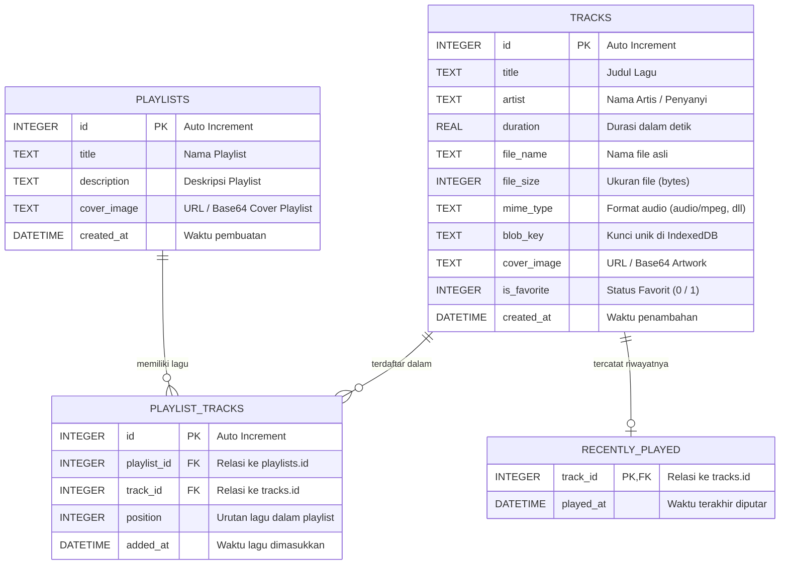
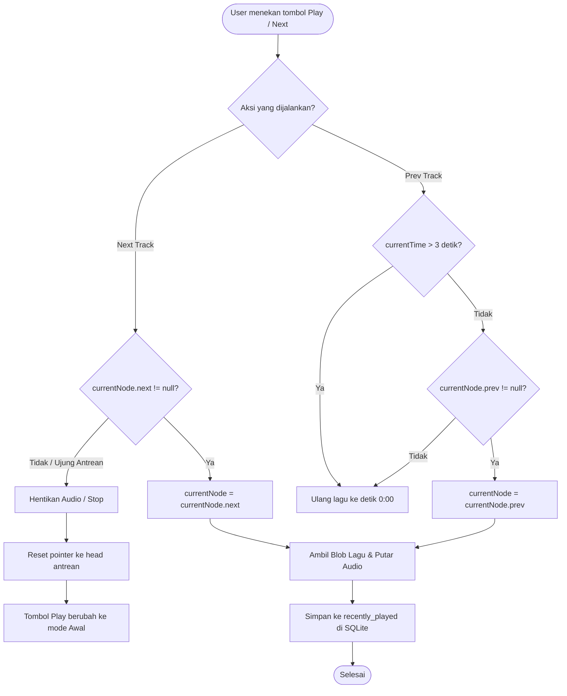
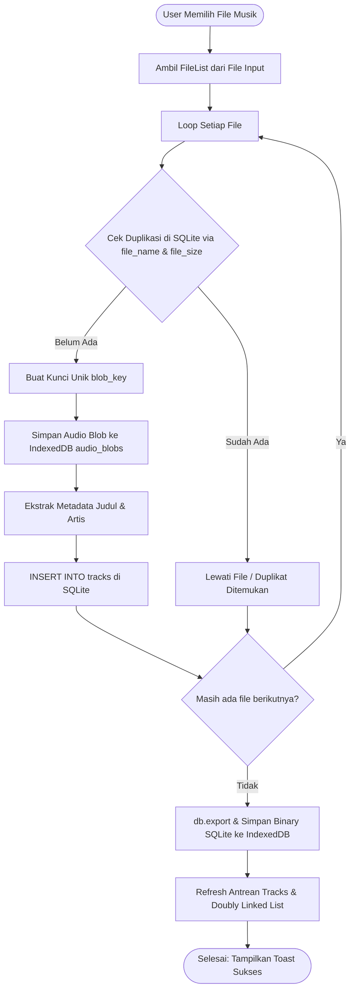
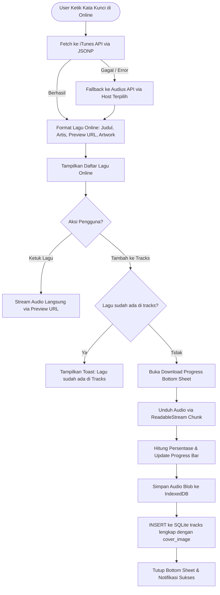

# 🎵 PANDUAN MATERI PRESENTASI PROYEK KAKAWIHAN

> **Aplikasi Pemutar Musik Modern (PWA) Offline-Ready & Online Streaming**  
> Mengintegrasikan Struktur Data **Doubly Linked List** dengan Pointer Node dan **SQLite (sql.js WebAssembly)** yang Terpersistensi di **IndexedDB**.

---

## 📑 DAFTAR ISI
1. [Ringkasan Eksekutif & Arsitektur Sistem](#1-ringkasan-eksekutif--arsitektur-sistem)
2. [Solusi Database Admin: phpMyAdmin untuk sql.js](#2-solusi-database-admin-phpmyadmin-untuk-sqljs)
3. [Struktur Data: Doubly Linked List & Pointer Node](#3-struktur-data-doubly-linked-list--pointer-node)
4. [Entity Relationship Diagram (ERD)](#4-entity-relationship-diagram-erd)
5. [Flowchart Sistem & Alur Logika](#5-flowchart-sistem--alur-logika)
6. [Fitur-Fitur Utama Aplikasi](#6-fitur-fitur-utama-aplikasi)
7. [Panduan Slide-by-Slide & Skrip Presentasi Kelompok](#7-panduan-slide-by-slide--skrip-presentasi-kelompok)
8. [Tips & Trik Menghadapi Pertanyaan Dosen / Penguji](#8-tips--trik-menghadapi-pertanyaan-dosen--penguji)

---

## 1. RINGKASAN EKSEKUTIF & ARSITEKTUR SISTEM

### 1.1 Identitas Aplikasi
- **Nama Aplikasi:** Kakawihan (berasal dari bahasa Sunda yang berarti bernyanyi / tembang lagu).
- **Jenis Aplikasi:** Progressive Web App (PWA) Mobile-First.
- **Tujuan Utama:** Memungkinkan pengguna memutar lagu secara offline dari penyimpanan lokal, mencari dan streaming musik online tanpa batas, mengelompokkan lagu ke dalam playlist, serta mengelola antrean musik menggunakan struktur data Doubly Linked List.

### 1.2 Tech Stack
| Lapisan | Teknologi | Peran & Alasan Pemilihan |
| :--- | :--- | :--- |
| **Frontend UI** | React 19 + TypeScript | UI berbasis komponen yang reaktif, aman terhadap tipe data (*type-safe*). |
| **Styling** | Tailwind CSS | Desain dark theme mobile-first (`#101012`) modern menyerupai iOS / Spotify. |
| **Relational Database** | `sql.js` (SQLite WASM) | Engine relasional SQL murni yang berjalan 100% di browser pengguna tanpa ketergantungan server database eksternal. |
| **Blob & Binary Storage** | IndexedDB | Menyimpan snapshot file binary `.sqlite` dan file audio mentah (*Blob*) hingga kapasitas ratusan megabyte. |
| **Data Structure** | Doubly Linked List (DLL) | Antrean pemutaran lagu dengan traversal pointer dua arah ($O(1)$) dan *terminal stop*. |
| **Audio Engine** | HTML5 Audio API | Pengontrol buffer audio, seeker slider, dan event listener pemutaran. |
| **Online Music API** | Audius API + iTunes API | Sumber lagu online legal gratis dengan gateway dinamis & streaming fallback. |

---

## 2. SOLUSI DATABASE ADMIN: DATA STUDIO UNTUK SQLite (sql.js)

### 2.1 Mengapa phpMyAdmin Konvensional Tidak Bisa Terhubung Langsung?
- **phpMyAdmin Tradisional:** Didesain khusus untuk **MySQL / MariaDB** yang berjalan pada arsitektur server-client terpusat (server mendengarkan port TCP seperti 3306).
- **sql.js:** Merupakan SQLite yang di-compile ke WebAssembly (WASM). Databasenya hidup di dalam **memori RAM browser pengguna** (client-side) dan disimpan secara persisten ke **IndexedDB** browser. Tidak ada port TCP server yang terbuka untuk disambungkan oleh phpMyAdmin biasa.

### 2.2 Data Studio: Admin SQLite In-Browser
Aplikasi Kakawihan menyediakan fitur bawaan **Data Studio** yang dibuat khusus sesuai design system aplikasi (dark theme `#101012`, rounded pill buttons, tanpa uppercase).

```
                     ┌───────────────────────────────────────────────┐
                     │           SQLite Database (sql.js)            │
                     │          Tersimpan di IndexedDB Browser       │
                     └───────────────────────┬───────────────────────┘
                                             │
             ┌───────────────────────────────┴──────────────────────────────┐
             ▼                                                              ▼
    [Path Route Tersembunyi]                                       [3 Fitur Utama Data Studio]
    http://localhost:5173/studio                                   1. Tabel Data (Data Explorer & Search)
    Membypass mobile check untuk presentasi laptop                  2. SQL Konsol (Query Runner & Presets)
    Tanpa tombol di antarmuka utama aplikasi musik                  3. Skema & ERD (Diagram Relasi Antartabel)
```

#### Cara Mengakses & Fitur Data Studio:
1. **Akses via Path Route:**
   - Cukup buka URL: `http://localhost:5173/studio` (atau `/data-studio`).
   - Rute ini otomatis membypass pembatasan tampilan mobile sehingga dapat langsung didemonstrasikan di layar laptop/proyektor presentasi.
   - Tidak ada tombol di antarmuka pemutar musik utama agar tampilan aplikasi tetap bersih dan elegan.
2. **Fitur-Fitur Data Studio:**
   - **Tabel Data:** Menampilkan seluruh tabel (`tracks`, `playlists`, `playlist_tracks`, `recently_played`), jumlah baris real-time, pencarian data interaktif, dan pagination.
   - **SQL Konsol:** Menjalankan perintah SQL manual (`SELECT`, `INSERT`, `UPDATE`, dsb.) dengan execution time, hasil eksekusi tabel, dan contoh preset query cepat.
   - **Skema & ERD:** Diagram relasi antar tabel (1:N, M:N) serta detail atribut kolom, tipe data, *primary key* (`pk`), dan *foreign key* (`fk`).

---

## 3. STRUKTUR DATA: DOUBLY LINKED LIST & POINTER NODE

### 3.1 Mengapa Memilih Doubly Linked List Dibanding Array Biasa?

| Aspek Operasi | Array Biasa | Doubly Linked List (Node) | Keunggulan Doubly Linked List |
| :--- | :--- | :--- | :--- |
| **Navigasi Next** | Akses index $O(1)$ | Geser pointer `current = current.next` $O(1)$ | Sangat intuitif memodelkan pemutaran musik |
| **Navigasi Prev** | Akses index $O(1)$ | Geser pointer `current = current.prev` $O(1)$ | Memiliki pointer balik eksplisit |
| **Sisip Lagu di Tengah** | $O(N)$ (harus menggeser semua elemen berikutnya) | $O(1)$ (hanya menyambung 4 pointer node) | Efisien saat pengguna menyusun ulang antrean (*reorder queue*) |
| **Hapus Lagu dari Antrean** | $O(N)$ (harus shifting elemen di memori) | $O(1)$ (memutus pointer node terkait) | Tidak memerlukan realokasi memori berulang |
| **Indikator Batas Antrean** | Memeriksa nilai index terhadap `.length - 1` | `node.next === null` (pointer bernilai null) | Deteksi alami ujung antrean tanpa manipulasi angka index |

### 3.2 Anatomi Node dan Pointer

Setiap lagu di dalam antrean dibungkus di dalam sebuah objek **Node**:

```
                 DoublyLinkedListNode<Track>
             ┌─────────────────────────────────┐
             │  prev: DoublyLinkedListNode | null
             ├─────────────────────────────────┤
             │  data: Track                    │
             ├─────────────────────────────────┤
             │  next: DoublyLinkedListNode | null
             └─────────────────────────────────┘
```

Visualisasi memori antrean lagu:

```
        HEAD                                                    TAIL
         │                                                       │
         ▼                                                       ▼
   ┌───────────┐         ┌───────────┐         ┌───────────┐
NULL ◄──┤ Node A    ├────────►┤ Node B    ├────────►┤ Node C    ├──► NULL
   └───┤ Lagu #1   │◄────────┤ Lagu #2   │◄────────┤ Lagu #3   │
       └───────────┘         └───────────┘         └───────────┘
                                   ▲
                                   │
                              CURRENT NODE
                           (Sedang Diputar)
```

### 3.3 Logika Pointer Traversal & Terminal Stop

1. **Next Track (`nextTrack`):**
   - Periksa pointer `currentNode.next`.
   - Jika `currentNode.next !== null`: Pointer bergerak maju (`currentNode = currentNode.next`), lagu diputar.
   - **Terminal Stop:** Jika `currentNode.next === null` (sudah mencapai lagu terakhir di ujung antrean), lagu berhenti (*stop*), tombol play berubah kembali menjadi ikon **Play**, dan pointer di-reset ke `head`.

2. **Previous Track (`prevTrack`):**
   - Jika durasi lagu yang sedang berjalan sudah lebih dari 3 detik: Lagu diulang dari detik ke-0 (standar player profesional).
   - Jika kurang dari 3 detik dan `currentNode.prev !== null`: Pointer bergerak mundur (`currentNode = currentNode.prev`).

3. **Looping / Repeat:**
   - Karena struktur dasarnya adalah linear Doubly Linked List (bukan Circular Linked List), antrean memiliki ujung yang jelas (`tail.next = null`), mencegah lagu berulang tanpa disadari pengguna kecuali tombol repeat diaktifkan.

---

## 4. ENTITY RELATIONSHIP DIAGRAM (ERD)

> File diagram visual interaktif draw.io tersedia di [erd.drawio](file:///home/fahmirizalbudi/Repositories/kakawihan/erd.drawio) (Notasi Chen klasik: Entitas, Relasi Belah Ketupat, Properti Relasi, Oval Atribut, dan Kardinalitas).

Aplikasi menggunakan engine relasional SQLite dengan 4 tabel yang saling terhubung secara terstruktur dan memiliki proteksi integritas data (*Foreign Keys* dengan `ON DELETE CASCADE`).



### Penjelasan Integritas Relasi:
1. **Integritas Referensial (`ON DELETE CASCADE`):** Jika lagu pada tabel `tracks` dihapus, seluruh entri lagu tersebut pada tabel relasi `playlist_tracks` dan `recently_played` otomatis terhapus tanpa meninggalkan data yatim (*orphan data*).
2. **Kunci Unik Ganda (`UNIQUE(playlist_id, track_id)`):** Menjamin sebuah lagu tidak dapat diduplikasi ganda dalam satu playlist yang sama.
3. **Penyimpanan Dua Lapis (*Two-Tier Storage*):** Metadata lagu (judul, ukuran, artist, cover) disimpan di SQLite untuk query cepat, sedangkan konten audio (Blob ukuran megabyte) disimpan di IndexedDB `audio_blobs` dengan referensi `blob_key`.

---

## 5. FLOWCHART SISTEM & ALUR LOGIKA

> File diagram visual interaktif draw.io tersedia di [flowchart-dll.drawio](file:///home/fahmirizalbudi/Repositories/kakawihan/flowchart-dll.drawio) (Notasi flowchart lengkap dengan rantai pointer node dan border putih minimalis).

### Flowchart 1: Traversal Pemutaran Lagu dengan Doubly Linked List



---

### Flowchart 2: Alur Scanning & Penyimpanan File Audio Lokal



---

### Flowchart 3: Pencarian Online, Streaming, & Download ke Tracks



---

## 6. FITUR-FITUR UTAMA APLIKASI

1. **Pemutar Audio Offline & Online:**
   - Pemutaran musik lokal tanpa koneksi internet.
   - Streaming lagu online dari database Audius dan iTunes.
   - MiniPlayer dengan seeker bar, timestamps, dan status buffering.
2. **Antrean Navigasi Doubly Linked List:**
   - Navigasi Next dan Previous berkecepatan tinggi $O(1)$.
   - Fitur *Terminal Stop*: Lagu berhenti secara rapi saat mencapai ujung playlist.
3. **Manajemen Playlist Modern:**
   - Membuat playlist dengan sampul gambar kustom.
   - Mengubah nama playlist dan lagu (Rename feature).
   - Menambah atau menghapus lagu dari playlist.
   - Active player card dengan tombol kontrol langsung di baris lagu playlist.
4. **Pencegahan Duplikasi (Deduplication):**
   - Sistem cerdas mencegah lagu lokal ganda saat pemindaian file.
   - Mencegah lagu online yang sama diunduh dua kali ke tab Tracks.
5. **Progress Bar Bottom Sheet:**
   - Animasi proses unduh audio online dengan indikator persentase real-time dan preview thumbnail.
6. **Favorites & Recently Played:**
   - Menandai lagu kesukaan (*one-click favorite*).
   - Riwayat lagu yang baru saja diputar tersimpan otomatis di SQLite.
7. **Built-in SQLite Database Studio:**
   - Antarmuka GUI setara phpMyAdmin langsung di dalam aplikasi untuk memeriksa dan memanipulasi database.

---

## 7. PANDUAN SLIDE-BY-SLIDE & SKRIP PRESENTASI KELOMPOK

Gunakan panduan berikut untuk membagi materi presentasi kepada anggota kelompok:

### 🎤 Slide 1: Judul & Anggota Tim
- **Isi Slide:**
  - Judul: **KAKAWIHAN: Aplikasi Pemutar Musik Modern Berbasis Doubly Linked List & SQLite WASM**
  - Mata Kuliah: Struktur Data / Basis Data / Pemrograman Web
  - Nama Dosen Pengampu & Daftar Anggota Kelompok
- **Skrip Bicara (Speaker 1):**
  > *"Selamat pagi/siang Bapak/Ibu dosen dan rekan-rekan sekalian. Hari ini kelompok kami akan mempresentasikan proyek aplikasi Kakawihan, sebuah pemutar musik PWA modern yang memadukan keunggulan struktur data Doubly Linked List dengan engine database relasional SQLite berbasis WebAssembly di browser."*

---

### 🎤 Slide 2: Latar Belakang & Rumusan Masalah
- **Isi Slide:**
  - Keterbatasan streaming musik konvensional (boros kuota, lag di area minim sinyal).
  - Ketidakefisienan struktur data Array untuk antrean pemutaran musik dinamis.
  - Kebutuhan database relasional yang independen tanpa konfigurasi server backend yang rumit.
- **Skrip Bicara (Speaker 1):**
  > *"Sebagian besar pemutar web menyimpan antrean dalam Array biasa. Ketika lagu diubah atau dihapus, operasi shifting memori membutuhkan waktu O(N). Selain itu, penyimpanan data browser seringkali hanya mengandalkan LocalStorage yang terbatas dan tidak mendukung relasi SQL. Oleh karena itu, kami merancang arsitektur baru yang menggabungkan Doubly Linked List dan SQLite di sisi klien."*

---

### 🎤 Slide 3: Arsitektur Sistem (Client-Side WASM + IndexedDB)
- **Isi Slide:**
  - Diagram arsitektur: Browser $\rightarrow$ React 19 $\rightarrow$ sql.js (WASM) $\rightarrow$ IndexedDB.
  - Mengapa WebAssembly? Eksekusi query secepat C/C++ langsung di memori browser.
  - Mekanisme Two-Tier Storage: SQLite untuk metadata, IndexedDB untuk audio binary.
- **Skrip Bicara (Speaker 2):**
  > *"Di balik layar, aplikasi kami menggunakan teknologi sql.js yang meng-compile source code C dari SQLite ke WebAssembly. Setiap perubahan data diekspor sebagai byte array dan disimpan secara persisten di IndexedDB, sehingga saat browser di-refresh atau ditutup, data tidak akan hilang."*

---

### 🎤 Slide 4: Database Admin (Konsep phpMyAdmin di Klien)
- **Isi Slide:**
  - Penjelasan perbedaan arsitektur phpMyAdmin (MySQL server) vs SQLite client-side.
  - Solusi yang dihadirkan: **Secret URL Export** (`?export-db`) + **DB Browser for SQLite**.
  - Cara memeriksa database: Ekspor binary `.sqlite` secara instan dan buka di tools GUI standar.
- **Skrip Bicara (Speaker 2):**
  > *"Banyak yang bertanya bagaimana cara melihat data di SQLite tanpa server? Kami menyediakan solusinya: Secret URL Export `?export-db`. Cukup dengan mengakses URL tersebut, file binary SQLite akan langsung terunduh dan dapat dibuka di DB Browser for SQLite atau SQLiteOnline dengan tampilan dan fungsi yang sama persis seperti phpMyAdmin."*

---

### 🎤 Slide 5: Entity Relationship Diagram (ERD)
- **Isi Slide:**
  - Tampilkan diagram ERD (Tabel `tracks`, `playlists`, `playlist_tracks`, `recently_played`).
  - Soroti Foreign Key, `ON DELETE CASCADE`, dan relasi Many-to-Many antara Playlist dan Tracks.
- **Skrip Bicara (Speaker 3):**
  > *"Struktur basis data kami terdiri dari 4 tabel utama. Antara tabel playlists dan tracks terdapat tabel penghubung playlist_tracks dengan kunci unik ganda untuk mencegah lagu ganda. Kami juga menerapkan aturan ON DELETE CASCADE sehingga integritas data selalu terjaga."*

---

### 🎤 Slide 6: Struktur Data: Doubly Linked List & Pointer Node
- **Isi Slide:**
  - Struktur objek Node: `prev`, `data`, `next`.
  - Diagram pointer antrean lagu (`NULL <- A <-> B <-> C -> NULL`).
  - Perbandingan kompleksitas waktu: Operasi traversal dan manipulasi $O(1)$.
- **Skrip Bicara (Speaker 3):**
  > *"Inti dari antrean pemutaran musik kami adalah Doubly Linked List. Setiap lagu dibungkus dalam node yang memiliki pointer ke lagu sebelumnya (prev) dan lagu berikutnya (next). Hal ini memungkinkan navigasi dua arah yang sangat cepat dengan kompleksitas waktu konstan O(1)."*

---

### 🎤 Slide 7: Algoritma Traversal & Terminal Stop Behavior
- **Isi Slide:**
  - Flowchart traversal antrean musik.
  - Aturan tombol Previous (> 3 detik vs < 3 detik).
  - Penjelasan *Terminal Stop*: Lagu berhenti di akhir playlist tanpa looping tak terduga.
- **Skrip Bicara (Speaker 3):**
  > *"Kami menerapkan perilaku Terminal Stop. Ketika lagu terakhir selesai diputar dan pointer next bernilai NULL, pemutaran otomatis berhenti dan tombol kembali ke keadaan awal. Pointer antrean di-reset ke head sehingga pengguna dapat memutar ulang dari awal secara teratur."*

---

### 🎤 Slide 8: Fitur Utama: Offline Playback & Local Scanning
- **Isi Slide:**
  - Fitur Scan Folder Musik Lokal.
  - Validasi Anti-Duplikasi berdasarkan nama dan ukuran file.
  - Penyimpanan audio mentah ke IndexedDB.
- **Skrip Bicara (Speaker 4):**
  > *"Pengguna dapat memilih file musik dari perangkat mereka. Sistem akan secara otomatis memindai dan menyaring file yang terduplikasi sebelum menyimpannya ke IndexedDB. Lagu yang telah disimpan dapat diputar kapan saja tanpa memerlukan koneksi internet."*

---

### 🎤 Slide 9: Fitur Utama: Online Search & Streaming
- **Isi Slide:**
  - Pencarian online terintegrasi (Audius API & iTunes API).
  - Mekanisme Dynamic Gateway Fallback (tahan terhadap server error).
  - Fitur "Tambah ke Tracks" dengan cover art dan Progress Bar Bottom Sheet.
- **Skrip Bicara (Speaker 4):**
  > *"Untuk musik online, aplikasi kami terhubung dengan Audius API dan iTunes. Lagu dapat langsung di-streaming, atau disimpan ke koleksi Tracks lokal. Saat proses penyimpanan, aplikasi menampilkan Bottom Sheet interaktif dengan progress bar unduhan secara real-time."*

---

### 🎤 Slide 10: Fitur Utama: Playlist & UI Detail View
- **Isi Slide:**
  - Pembuatan dan pengelolaan Playlist dengan foto sampul kustom.
  - Tampilan Detail Playlist, Favorites, dan Recently Played yang mengadopsi design system terpadu.
  - Active Player Card dengan tombol kontrol langsung di baris lagu.
- **Skrip Bicara (Speaker 4):**
  > *"Tampilan detail playlist kami rancang dengan design system mobile yang konsisten. Ketika lagu sedang diputar di playlist, baris lagu tersebut berubah menjadi kartu kontrol aktif lengkap dengan tombol previous, pause/play, dan next."*

---

### 🎤 Slide 11: Live Demo Aplikasi (Demonstrasi Langsung)
- **Langkah-langkah Demo di Depan Penguji:**
  1. **Demo Pemutaran:** Buka tab **Tracks**, pilih sebuah lagu, tunjukkan MiniPlayer dan seeker slider.
  2. **Demo Doubly Linked List:** Tekan tombol *Next* dan *Previous*, jelaskan perpindahan pointer `current = current.next`.
  3. **Demo Terminal Stop:** Putar lagu terakhir di playlist, biarkan habis atau geser slider ke ujung, tunjukkan lagu berhenti dan tombol berubah kembali jadi Play.
  4. **Demo Database & Export Rahasia:**
     - Buka URL rahasia `http://localhost:5173/?export-db` di browser untuk langsung mengunduh binary SQLite `kakawihan.sqlite` secara otomatis tanpa tombol di UI.
     - Buka file tersebut di aplikasi desktop **DB Browser for SQLite** atau di **sqliteonline.com** untuk menunjukkan data tabel yang tersimpan kepada penguji.
  5. **Demo Online Streaming & Download:** Buka tab **Online**, cari sebuah lagu, putar preview, lalu tekan "Tambah ke Tracks" untuk memperlihatkan animasi Progress Bar Bottom Sheet.
- **Skrip Bicara (Semua Anggota Tim secara Bergantian saat Demo).**

---

### 🎤 Slide 12: Kesimpulan & Penutup
- **Isi Slide:**
  - Rangkuman keberhasilan proyek (integrasi struktur data murni + arsitektur basis data modern).
  - Skor Pengujian: 100% lolos unit test otomatis (Vitest).
  - Ucapan terima kasih & Pembukaan sesi Tanya Jawab.
- **Skrip Bicara (Speaker 1):**
  > *"Sebagai kesimpulan, proyek Kakawihan membuktikan bahwa struktur data fundamental seperti Doubly Linked List dan sistem basis data relasional SQLite dapat diimplementasikan secara optimal pada aplikasi web modern tanpa ketergantungan server backend. Terima kasih atas perhatian Bapak/Ibu dan rekan-rekan sekalian. Kami membuka sesi tanya jawab."*

---

## 8. TIPS & TRIK MENGHADAPI PERTANYAAN DOSEN / PENGUJI

### ❓ Pertanyaan 1: "Mengapa tidak pakai Circular Linked List saja untuk antrean?"
> **Jawaban:**  
> *"Circular Linked List membuat antrean berputar tanpa henti (tail terhubung kembali ke head). Namun, dalam aplikasi musik modern (seperti Spotify atau Apple Music), pengguna seringkali ingin antrean berhenti saat playlist selesai (Terminal Stop). Dengan Doubly Linked List biasa, kita memiliki node terminal (`tail.next = null`) yang memungkinkan penghentian otomatis dan kontrol yang lebih aman."*

### ❓ Pertanyaan 2: "Bagaimana cara kerja sql.js menyimpan data jika browser di-refresh?"
> **Jawaban:**  
> *"sql.js menjalankan SQLite di memori WebAssembly. Setiap kali terjadi operasi INSERT, UPDATE, atau DELETE, aplikasi mengekspor seluruh state database menjadi binary `Uint8Array` melalui fungsi `db.export()`. Binary ini kemudian kami simpan ke IndexedDB browser pada store `sqlite_store`. Saat aplikasi dibuka kembali, binary tersebut di-load kembali ke dalam instance sql.js."*

### ❓ Pertanyaan 3: "Apakah file MP3 disimpan di dalam SQLite?"
> **Jawaban:**  
> *"Tidak, demi efisiensi performa. File audio MP3/M4A berukuran beberapa megabyte disimpan sebagai Blob di IndexedDB terpisah (`audio_blobs`). SQLite hanya menyimpan metadata seperti judul, artis, ukuran, dan string kunci `blob_key`. Ini adalah prinsip Two-Tier Architecture yang menjaga database SQLite tetap ringan dan responsif."*

### ❓ Pertanyaan 4: "Berapa kapasitas maksimal penyimpanan lagu di aplikasi ini?"
> **Jawaban:**  
> *"Kapasitas penyimpanan dibatasi oleh kuota IndexedDB browser pengguna, yang umumnya mencapai 60% hingga 80% dari sisa ruang penyimpanan hard drive perangkat (bisa mencapai puluhan gigabyte). Dengan rata-rata ukuran lagu 3-5 MB, aplikasi dapat dengan mudah menyimpan ratusan hingga ribuan lagu secara offline."*

---
*Dokumen ini dibuat otomatis sebagai panduan resmi presentasi proyek Kakawihan.*
